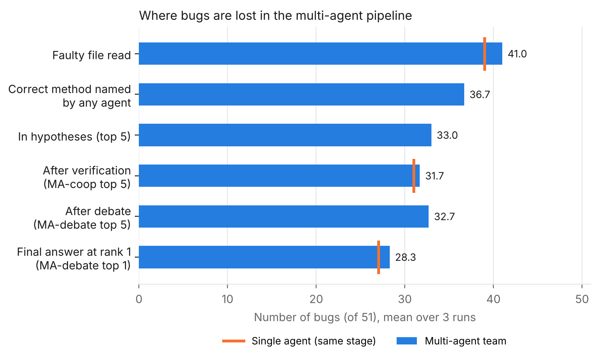
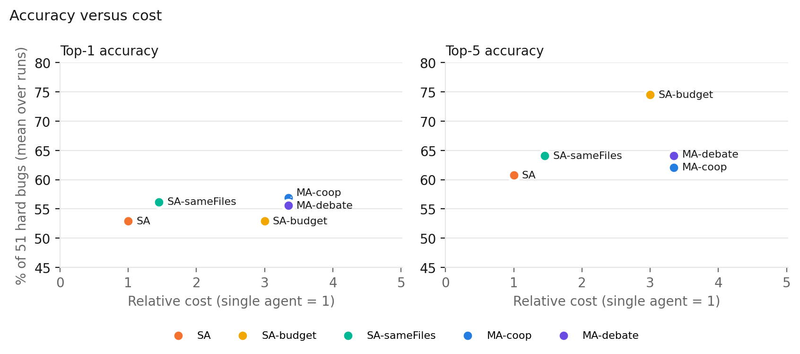

# Coordinated Multi-Agent Reasoning with LLMs for Automated Bug Localization

Code, data and results of the M.Sc. thesis by **Tina Ramezani**
(M.Sc. Artificial Intelligence, Department of Computer Engineering, Istinye University, Istanbul, 2026;
advisor: Dr. Ali Asghar Pourhaji Kazem).

The thesis asks whether a **team of LLM agents with different roles** (Trace Interpreter, Static Code Inspector,
Hypothesis Formulator, Verifier and an Adversarial Critic that debates with the Verifier) localizes the faulty
**method** of a Java bug better than a **single LLM agent**, on real bugs from [Defects4J](https://github.com/rjust/defects4j).

## Main findings

1. **Memorization.** Without seeing *any* source code (only the failing test and the stack trace), the model
   localized **81% (Top-5)** of 268 public Defects4J bugs, which points to benchmark contamination. All main
   experiments therefore use the **51 "hard" bugs** that the model could *not* localize without code.
2. **Team vs. single agent (51 hard bugs, 3 runs each, bug-level paired tests).** The team is slightly better at
   Top-1 (56.9% vs 52.9%; 5 vs 1 discordant bugs, exact McNemar p = 0.22). No comparison is statistically significant.
3. **Where the gain comes from.** A single agent that reads *the same files the team chose* (SA-sameFiles) matches
   the team (Top-1 56.2%, Top-5 64.1%) at less than half the cost. The useful part of the team is choosing files from
   two views (with and without the stack trace), not the verification or the debate.
4. **Verification and debate add nothing measurable.** The ranking before verification is as good as after it,
   and the debate changes many rankings but has no net effect on accuracy.
5. **Information is lost inside the team.** Some agent named a correct method in ~72% of the bugs, but the final
   answer contained it in only ~64%. In 6 cases the Critic proposed the correct method and was overruled.
6. **Cheap diversity wins.** Rank voting over 3 independent single-agent runs (SA-budget) reached the best
   Top-5 (74.5%) and MRR (0.624) of all configurations.

| Configuration (51 hard bugs) | Runs | Top-1 | Top-5 | MRR | Relative cost |
|---|---|---|---|---|---|
| Single agent (SA) | 3 | 52.9% | 60.8% | 0.565 | 1.00 |
| SA-budget (rank vote of 3 SA runs) | 1 | 52.9% | 74.5% | 0.624 | 3.00 |
| SA-sameFiles (SA reads the team's files) | 3 | 56.2% | 64.1% | 0.598 | 1.45 |
| Multi-agent, cooperative (MA-coop) | 3 | 56.9% | 62.1% | 0.593 | 3.35 |
| Multi-agent, with debate (MA-debate) | 3 | 55.6% | 64.1% | 0.592 | 3.35 |

Relative cost = input tokens + 6 x output/thinking tokens, single agent = 1. Full statistics are in
[`results/analysis_report.md`](results/analysis_report.md).




## Setup used

- Model: `gemini-3.5-flash` through Google Cloud Vertex AI (`google-genai` SDK 2.12.1), temperature 1.0,
  JSON output; the same model and settings for every agent and configuration.
- Benchmark: Defects4J (Java 11 version), 268 bugs from 11 projects -> 51 hard bugs after the no-code filter.
- Evaluation at method level: a prediction is correct if the file name and method name match a method changed by
  the developer's fix (answer key built from the Defects4J patches with a Java parser). Metrics: Top-1/3/5, MRR,
  file recall, tokens, latency. Statistics use the bug as the unit (exact McNemar, Wilcoxon, bootstrap 95% CI).
- Experiments ran between 2026-11-10 and 2026-11-25 in Google Colab. Total cost about EUR 85 of Google Cloud credit.

## Repository layout

```
colab/   the Colab cells, in the order they were run (paste each "=== Cell N" block into its own cell)
data/    ground_truth_v2.csv (answer key of the 40 pilot bugs), hard_bugs.csv (the 51 hard bugs)
results/ analysis_report.md (all tables and tests), extra_analyses.md, error_analysis_excerpts.md, figures/
```

| File | What it does |
|---|---|
| `cell01_06_setup_and_baseline.py` | Drive, Defects4J, code snapshots, Gemini client, single-agent baseline on 40 Lang/Math bugs |
| `cell07_10_inspection_answer_key_control.py` | inspect misses, show patches, rebuild the answer key from patches, no-code control |
| `cell11_12_more_bugs_memorization_filter.py` | add 228 bugs from 9 more projects, no-code control on all 268, select the 51 hard bugs |
| `cell13_single_agent.py` | single agent (SA) on the hard bugs (`RUN_ID` hard_run1/2/3) |
| `cell14_multi_agent.py` | the multi-agent framework (`RUN_ID` ma_run, ma_run2, ma_run3) |
| `cell15_analysis_statistics.py` | all configurations, paired statistics, consistency, subgroups, per-bug table |
| `cell16_sa_samefiles.py` | control: single agent given exactly the files the team chose |
| `cell17_error_excerpts.py` | transcript excerpts for the error analysis |
| `cell18_extra_analyses.py` | "named but lost" analysis, funnel and accuracy-vs-cost figures |

## How to reproduce

1. Create a Google Cloud project with Vertex AI enabled and put its id in `PROJECT_ID` (Cell 1).
2. In Colab, install the client: `!pip -q install google-genai==2.12.1 javalang scipy pandas matplotlib`.
3. Run Cells 1-4, then the cells in the table above in order. Every model cell is resumable: after a Colab reset,
   run Cell 1 and Cell 4 again and re-run the same cell. All files are written to `MyDrive/thesis` in Google Drive.

Results will not be identical (temperature 1.0, model updates), which is why every configuration was run 3 times.

## Citation

> T. Ramezani. *Coordinated Multi-Agent Reasoning with Large Language Models for Automated Bug Localization.*
> M.Sc. thesis, Istinye University, Istanbul, 2026.

## License

Code: MIT (see `LICENSE`). Defects4J and the projects it contains keep their own licenses.
